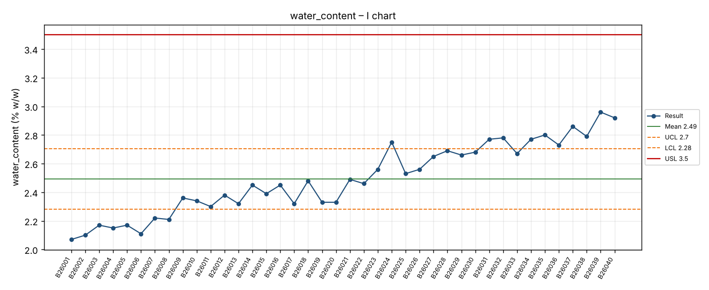

# apqr-toolkit

**Open-source statistics for pharmaceutical Annual Product Quality Reviews (APQR / PQR).**

Every year, QA teams in pharmaceutical companies have to trend every critical quality attribute of every product: assay, dissolution, water content, hardness, impurities and so on. In practice this is usually done by hand in Excel, one product at a time, with inconsistent formulas for Cpk and control limits. `apqr-toolkit` turns a simple CSV of batch results into a consistent, reviewable statistical summary in seconds.

> EU GMP Part I Chapter 1.10 and 21 CFR 211.180(e) require a periodic review of product quality, including trends of in-process and finished-product results. This tool helps prepare the statistical part of that review. It does not replace QA judgement.

## Features

- **Descriptive statistics**: n, mean, SD, RSD %, min, max, median
- **Process capability**: Cp / Cpk (within-batch sigma, MR̄/d₂) and Pp / Ppk (overall SD), with one-sided specs supported
- **I-MR control limits**: individuals chart with UCL / LCL
- **Out-of-trend detection**: Nelson / Western Electric rules 1, 2, 3 and 5 (outliers, shifts, drifts)
- **OOS flagging** against specification limits, by batch number
- **Control-chart images** (PNG) with control limits and spec limits
- **Reports** in Markdown, HTML and JSON, ready to paste into your APQR document
- A **verdict per parameter**: *In control*, *Out-of-trend signals - evaluate*, *In spec but not capable - evaluate*, *OOS results - CAPA required*

## Install

```bash
pip install git+https://github.com/qavalidation99-ship-it/apqr-toolkit2.git
```

Or from a local clone:

```bash
git clone https://github.com/qavalidation99-ship-it/apqr-toolkit2.git
cd apqr-toolkit2
pip install -e .
```

## Quick start

```bash
apqr analyze examples/sample_batches.csv --spec examples/specs.json \
     --out my_report --product "Demo Tablets 500 mg" --period "Jan–Dec 2026"
```

Output:

```
Analysed 4 parameter(s) over 40 batch(es).
  - assay: In control
  - dissolution_30min: OOS results - CAPA required
  - water_content: Out-of-trend signals - evaluate
  - hardness: In control
```

`my_report/` will contain `report.md`, `report.html`, `results.json` and `charts/*.png`.
A sample of the output is in [`examples/demo_report/report.md`](examples/demo_report/report.md).



## Input format

**Batch data (CSV):** one row per batch, in manufacturing order, with one column per parameter:

```csv
batch,manufacturing_date,assay,dissolution_30min,water_content,hardness
B26001,2026-01-05,100.2,91,2.07,85.3
B26002,2026-01-14,100.5,91,2.10,83.2
```

Only columns that appear in the spec file are analysed. Empty or non-numeric cells are ignored.

**Specifications (JSON):** `lsl` and/or `usl`, with an optional `unit`:

```json
{
  "assay":             {"lsl": 95, "usl": 105, "unit": "%"},
  "dissolution_30min": {"lsl": 80, "unit": "% (Q)"},
  "water_content":     {"usl": 3.5, "unit": "% w/w"}
}
```

## Use as a Python library

```python
from apqr import Spec, capability, control_limits, trend_rules

results = [100.2, 100.5, 100.0, 99.4, 100.9, 101.1]
spec = Spec(lsl=95, usl=105)

print(capability(results, spec))      # Cp, Cpk, Pp, Ppk
print(control_limits(results))        # centre line, UCL, LCL
print(trend_rules(results))           # Nelson-rule violations
```

## Methods

| Item | Formula |
|---|---|
| Within sigma | σ_w = MR̄ / 1.128 |
| Control limits | X̄ ± 3σ_w |
| Cp / Cpk | (USL − LSL) / 6σ_w ; min(USL − X̄, X̄ − LSL) / 3σ_w |
| Pp / Ppk | Same, using the overall sample SD |
| Rule 1 | 1 point beyond 3σ |
| Rule 2 | 9 points in a row on the same side of the mean |
| Rule 3 | 6 points in a row steadily increasing or decreasing |
| Rule 5 | 2 of 3 points beyond 2σ on the same side |

Interpretation of Ppk: ≥ 1.67 highly capable · ≥ 1.33 capable · ≥ 1.0 marginal · < 1.0 not capable.

## Validation note

If you use this tool for GMP decisions, verify it in your own environment according to your computerised-system procedures (e.g. GAMP 5 category 4/5 approach). The unit tests in `tests/` are a starting point for that verification. They check the formulas against hand-calculated values.

## Roadmap

- [ ] Excel (.xlsx) input and output
- [ ] Multiple products in one run
- [ ] Moving-range chart and histogram images
- [ ] Stability-data trending (regression and shelf-life estimate)
- [ ] Word (.docx) report export

Contributions and issues are welcome.

## License

[MIT](LICENSE)
