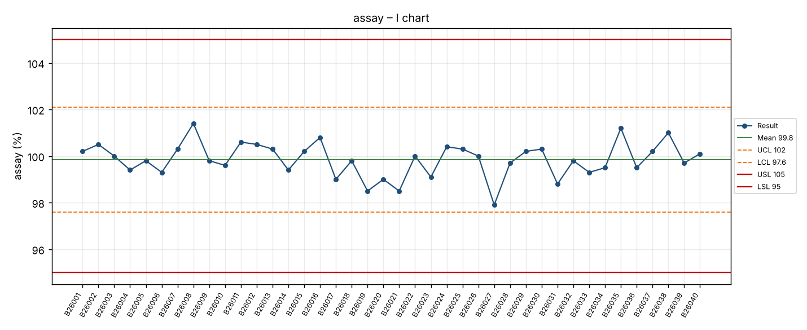
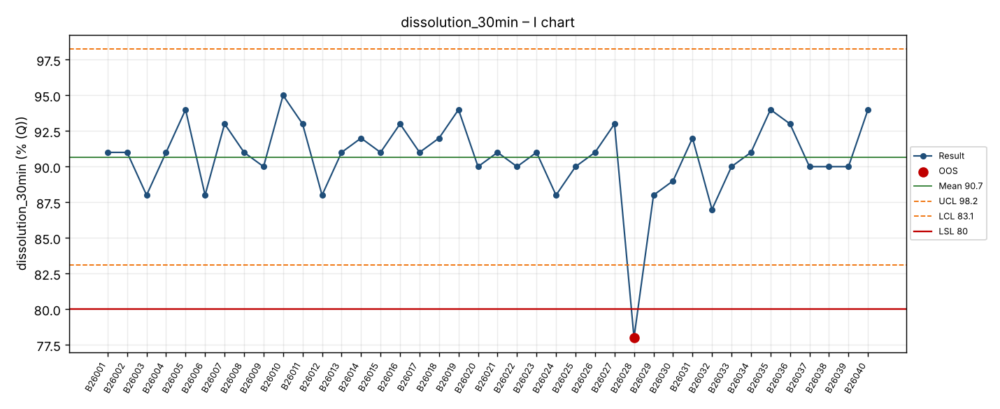
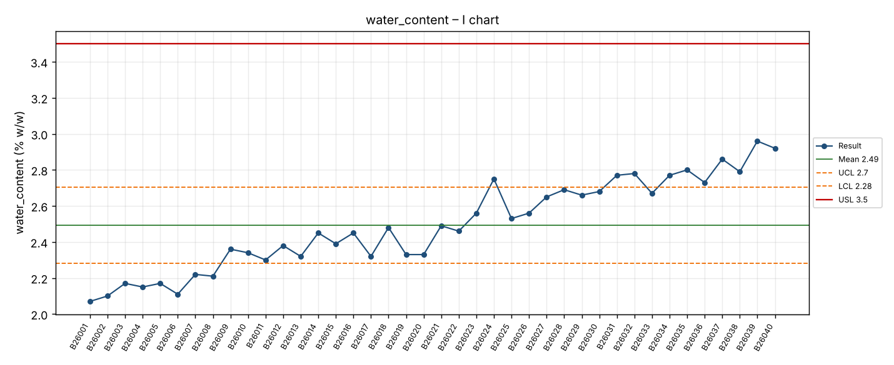
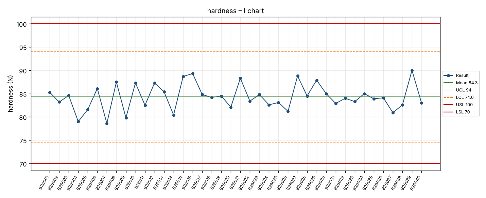

# APQR Statistical Summary – Demo Tablets 500 mg

**Review period:** Jan–Dec 2026  
**Generated:** 2026-11-25 with apqr-toolkit  

| Parameter | Spec | n | Mean | SD | RSD % | Min | Max | Cpk | Ppk | OOS | Verdict |
|---|---|---|---|---|---|---|---|---|---|---|---|
| assay | 95 – 105 % | 40 | 99.847 | 0.743 | 0.74 | 97.900 | 101.400 | 2.15 | 2.18 | 0 | In control |
| dissolution_30min | ≥ 80 % (Q) | 40 | 90.675 | 2.832 | 3.12 | 78.000 | 95.000 | 1.41 | 1.26 | 1 | OOS results - CAPA required |
| water_content | ≤ 3.5 % w/w | 40 | 2.493 | 0.249 | 10.00 | 2.070 | 2.960 | 4.78 | 1.35 | 0 | Out-of-trend signals - evaluate |
| hardness | 70 – 100 N | 40 | 84.287 | 2.811 | 3.33 | 78.600 | 90.000 | 1.47 | 1.69 | 0 | In control |

## assay

- Control limits (I-chart): LCL 97.590 / CL 99.847 / UCL 102.105
- Capability: Ppk 2.18 → Highly capable
- OOS batches: None
- Trend rules: no signals

## dissolution_30min

- Control limits (I-chart): LCL 83.105 / CL 90.675 / UCL 98.245
- Capability: Ppk 1.26 → Marginally capable - monitor
- OOS batches: B26028
- Rule 1: Point beyond 3σ control limit – batches B26028

## water_content

- Control limits (I-chart): LCL 2.283 / CL 2.493 / UCL 2.704
- Capability: Ppk 1.35 → Capable
- OOS batches: None
- Rule 1: Point beyond 3σ control limit – batches B26001, B26002, B26003, B26004, B26005, B26006, B26007, B26008, B26024, B26031, B26032, B26034, B26035, B26036, B26037, B26038, B26039, B26040
- Rule 2: 9 consecutive points on the same side of the mean (shift) – batches B26001, B26002, B26003, B26004, B26005, B26006, B26007, B26008, B26009, B26010, B26011, B26012, B26013, B26014, B26015, B26016, B26017, B26018, B26019, B26020, B26021, B26022, B26023, B26024, B26025, B26026, B26027, B26028, B26029, B26030, B26031, B26032, B26033, B26034, B26035, B26036, B26037, B26038, B26039, B26040
- Rule 5: 2 of 3 consecutive points beyond 2σ on the same side – batches B26001, B26002, B26003, B26004, B26005, B26006, B26007, B26008, B26010, B26011, B26013, B26017, B26019, B26020, B26027, B26028, B26029, B26030, B26031, B26032, B26033, B26034, B26035, B26036, B26037, B26038, B26039, B26040

## hardness

- Control limits (I-chart): LCL 74.570 / CL 84.287 / UCL 94.005
- Capability: Ppk 1.69 → Highly capable
- OOS batches: None
- Trend rules: no signals

---
*Statistics support, but do not replace, QA review and conclusions in the APQR.*
